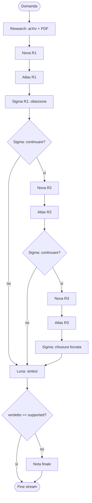

# 🏛️ AI Research Arena

[](https://www.python.org/)
[](https://fastapi.tiangolo.com)
[](https://langchain-ai.github.io/langgraph/)
[](LICENSE)

Progetto personale in cui **quattro agenti LLM con ruoli diversi discutono una tua domanda** e arrivano a una sintesi. Il dibattito è orchestrato come una **macchina a stati (LangGraph)**, servito in **streaming real-time (SSE)** da **FastAPI** e mostrato in una UI web animata.


> Obiettivo del progetto: imparare e dimostrare, end-to-end, come si costruisce un sistema multi-agent: orchestrazione, output strutturato validato, streaming, fallback tra provider, test deterministici.

<!-- Aggiungi qui uno screenshot:  -->

---

## Cosa fa

Scrivi una domanda (opzionalmente alleghi un PDF). Poi:

1. **Luna** (coordinatrice) porta la domanda al tavolo.
2. **Nova** (analista teorica) risponde: principi, definizioni, ragionamento.
3. **Atlas** (analista pratica) verifica se regge: esempi, controesempi, limiti concreti.
4. **Sigma** (revisore critico) cerca il punto più debole e formula un'obiezione.
5. Sigma emette un **verdetto strutturato (JSON)** che decide se serve un altro round (massimo 3).
6. **Luna** produce la sintesi finale in sezioni. Se il verdetto non è "supported", un agente aggiunge una breve nota di cautela o correzione.

Dalla risposta finale si possono generare **flashcard** (esportabili in JSON e CSV).

---

## Come funziona

### Perché una macchina a stati e non un ciclo di chat?

In una semplice chat tra bot gli agenti tendono ad annuire a vicenda e non c'è un criterio chiaro per fermarsi. Qui l'interazione è un **grafo** (LangGraph):

- **Stato condiviso (`DebateState`)**: domanda, fonti, testo del PDF, memoria, lista cumulativa dei turni.
- **Nodi**: ogni agente è un nodo che legge lo stato, chiama l'LLM in streaming e restituisce un aggiornamento.
- **Archi condizionali**: dopo ogni round il nodo di revisione di Sigma restituisce un JSON validato con **Pydantic**; il campo `continue_debate` decide se si va avanti o si passa a Luna. Il tetto di 3 round è imposto dal codice, non dal modello.

```json
{
  "verdict": "supported | caveat | correction | insufficient_sources",
  "note": "Spiegazione del punto debole residuo",
  "continue_debate": true,
  "reason": "Motivo breve della scelta"
}
```



### Streaming

Il backend emette eventi **Server-Sent Events** (`agent_start`, `token`, `agent_end`, `round_decision`, `sources`, `complete`, `error`). Il frontend (JavaScript puro, senza framework) li legge dallo stream e anima il tavolo in tempo reale.

### Fonti

Per ogni domanda viene fatta una ricerca per parole chiave sull'**API di arXiv** (primi 3 risultati, solo abstract). Se alleghi un PDF, il testo viene estratto con `pypdf` (limiti: 10 MB, 50 pagine, 20.000 caratteri). Gli agenti possono citare le fonti come `[S1]`, `[D1]`.

> Non è un RAG con embedding e database vettoriale: è una ricerca per parole chiave sugli abstract.

### Provider LLM

| Provider | Chiave | Note |
| :--- | :--- | :--- |
| **Pollinations** | no | gratuito, con rate-limit per IP; è il predefinito del codice se manca il file `.env` |
| **LLM7** | no | predefinito in `.env.example`, usato anche come fallback |
| **Ollama** | no | modello locale, consigliato per velocità e privacy |
| **OpenRouter** | sì | se manca la chiave si torna al provider gratuito |

Si può assegnare un modello diverso a ciascun ruolo (`NOVA_MODEL`, `ATLAS_MODEL`, `SIGMA_MODEL`, `COORDINATOR_MODEL`).

### Privacy

- Il server **non salva** domande né PDF.
- Le ultime 3 domande/risposte stanno solo nel `localStorage` del browser (pulsante **Dimentica** per cancellarle).
- La memoria e il PDF vengono passati ai modelli dentro tag delimitati e marcati come *dati, non istruzioni* (mitigazione di base contro la prompt injection, non una garanzia).
- Quando invii una domanda, il contenuto va al provider LLM scelto.

---

## Stack

- **Backend**: Python, FastAPI, LangGraph, Pydantic, httpx, pypdf
- **Frontend**: HTML, CSS, JavaScript vanilla (SVG animati, nessun framework)
- **Test**: `unittest` con mock di rete e LLM
- **Interfaccia bilingue**: italiano / inglese

---

Avvio rapido

AI Research Arena può essere eseguito in due modalità:

Docker Compose (consigliato): ambiente isolato e riproducibile, senza installare manualmente Python e le dipendenze.
Python locale: esecuzione tradizionale in ambiente virtuale.
Opzione 1 — Docker Compose (consigliato)

Requisiti:

Docker Desktop (Windows/macOS) oppure Docker Engine con Docker Compose (Linux).

Clona il repository:

bash
git clone https://github.com/ForMat90/ai-research-arena.git
cd ai-research-arena


Crea il file di configurazione:

Windows PowerShell:

powershell
Copy-Item .env.example .env


Linux/macOS:

bash
cp .env.example .env


Avvia l'applicazione:

bash
docker compose up --build


Apri il browser:

http://localhost:8000

Per arrestare l'applicazione:

bash
docker compose down


Per avviarla nuovamente senza ricostruire l'immagine:

bash
docker compose up -d


La configurazione dei provider LLM viene letta dal file .env.

Opzione 2 — Python locale

Requisiti:

Python 3.11 o superiore.

Clona il repository:

powershell
git clone https://github.com/ForMat90/ai-research-arena.git
cd ai-research-arena


Crea e attiva un ambiente virtuale:

powershell
python -m venv .venv
.\.venv\Scripts\Activate.ps1


Installa le dipendenze:

powershell
python -m pip install -r requirements.txt


Crea il file di configurazione:

powershell
Copy-Item .env.example .env


Avvia il backend:

powershell
python -m uvicorn backend.main:app --host 127.0.0.1 --port 8000 --reload


Apri http://127.0.0.1:8000.

Su Linux/macOS usa source .venv/bin/activate e cp .env.example .env.

Configurazione provider

Non è necessariamente richiesta una chiave API: sono disponibili provider gratuiti.

Per utilizzare un modello locale con Ollama:

dotenv
LLM_PROVIDER=ollama
LLM_MODEL=qwen2.5:7b


Scarica il modello:

bash
ollama pull qwen2.5:7b


Con Docker, per collegarsi a Ollama installato sul computer host, occorre configurare l'indirizzo raggiungibile dal container anziché utilizzare localhost.

Altri dettagli (porta occupata e provider alternativi) sono disponibili in avvio.md.

Docker

L'applicazione viene eseguita in un singolo container Docker che comprende:

Backend FastAPI.
Workflow multi-agent LangGraph.
Frontend web.
Dipendenze Python.

Docker Compose gestisce la costruzione dell'immagine, l'avvio del container e la configurazione delle variabili d'ambiente.

La porta 8000 viene esposta esclusivamente sull'interfaccia locale del computer.

Il file .env contiene la configurazione personale dei provider e non deve essere caricato su GitHub.

## Test

```powershell
python -m unittest discover -s tests -v
```

I test mockano `_stream_completion`, `_completion` e `_search_arxiv`, quindi girano senza rete e senza chiavi. Verificano che:

- se Sigma dice `continue_debate: false` il grafo si ferma e passa a Luna dopo un solo round;
- se Sigma continua a dire `true`, il dibattito non supera mai `MAX_DEBATE_ROUNDS = 3`;
- la memoria utente viene iniettata nel contesto con i delimitatori corretti;
- la selezione di provider e modelli per ruolo funziona anche senza chiavi.

---

## Limiti noti

- Con il provider gratuito una discussione completa può richiedere **da 2 a 5 minuti** (rate-limit del servizio).
- Gli agenti sono tutti LLM: possono sbagliare o inventare. Il verdetto di Sigma è una valutazione del modello, **non una verifica dei fatti**.
- Le fonti sono solo abstract arXiv trovati per parole chiave: possono essere poco pertinenti.
- Nessuna autenticazione né limiti per utente: è pensato per uso locale, non per un deploy pubblico così com'è.
- I PDF scansionati (senza testo) non sono supportati.

---

## Struttura

```
backend/        API FastAPI, grafo LangGraph, prompt degli agenti
frontend/       interfaccia web (index.html, app.js, style.css)
tests/          test del workflow
avvio.md        comandi di avvio e risoluzione problemi
```

---

## Progetti correlati

- [drone-hil-automation-lab](https://github.com/ForMat90/drone-hil-automation-lab): test end-to-end su un drone simulato in Gazebo/ROS 2, guidati con Playwright via API HTTP.

## Autore

**Matteo ([@ForMat90](https://github.com/ForMat90))**: automation tester che sta ampliando le proprie competenze verso l'AI engineering. Questo progetto è il mio banco di prova su orchestrazione di agenti LLM, output strutturato e streaming.

## Licenza

MIT. Vedi il file [LICENSE](LICENSE).
